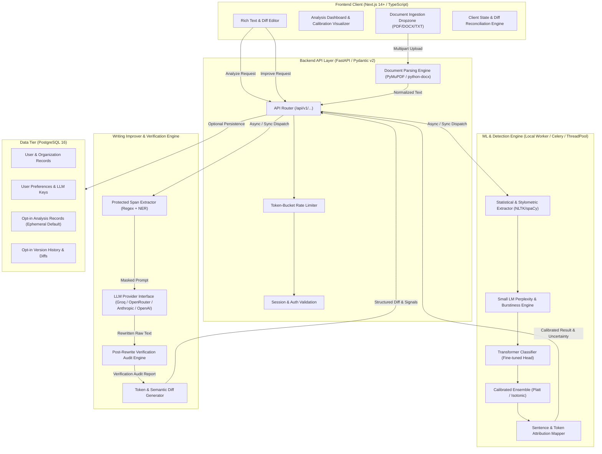
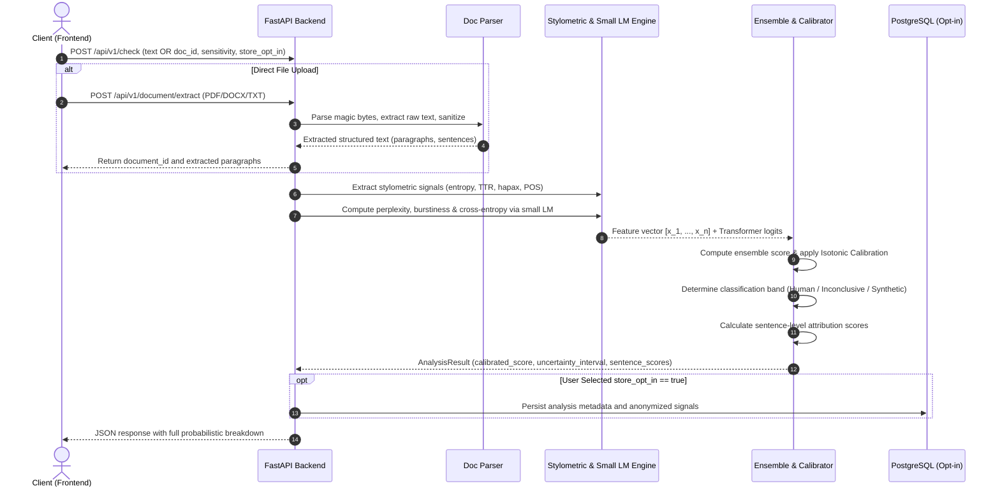
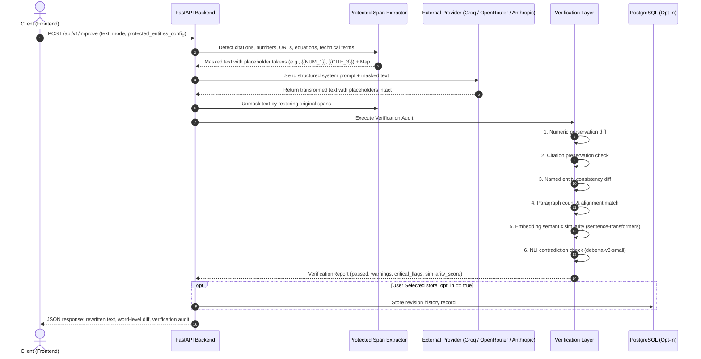

# System Architecture Specification

## 1. Executive Summary

BundCheck is a production-oriented platform providing two core capabilities:
1. **Module A (Content Checker)**: Statistically grounded, multi-signal AI text analysis. Outputs calibrated probabilities, explicit uncertainty intervals, sentence-level attribution, and explanatory linguistic indicators. It **never** asserts absolute proof of authorship and disallows "Ask an LLM if this is AI" approaches.
2. **Module B (Writing Improver)**: Multi-mode writing enhancement preserving semantic meaning, technical terms, numerical values, and academic citations. Features a strict post-generation verification audit and interactive diff review.

---

## 2. Component Architecture



---

## 3. Data Flow

### 3.1 Module A: Check (Analysis) Data Flow



### 3.2 Module B: Writing Improver & Verification Data Flow



---

## 4. Module Boundaries & Isolation

To ensure strict separation of concerns, the system enforces the following boundaries:

1. **Frontend (`frontend/`)**:
   - Zero access to ML libraries, PyTorch, or DB drivers.
   - All state is synchronized through typed client SDK calling `/api/v1/`.
   - Local state handles diff staging (accept/reject per token/sentence).
2. **Backend Services (`backend/`)**:
   - Responsible for request validation (Pydantic v2), authentication, rate limiting, and document extraction.
   - Dispatches inference requests to `ml/` via an in-memory or background worker queue.
   - Contains zero prompt engineering specifics for external models; interacts with LLMs exclusively through the `LLMProvider` abstraction.
3. **ML Core (`ml/`)**:
   - Stateless library design. Given raw text or token sequences, outputs structured numeric signal dictionaries.
   - Decoupled from HTTP frameworks, database models, and web dependencies.
   - Capable of being packaged into standalone worker containers or run synchronously in-process.

---

## 5. Swappable Provider Abstraction for LLM Inference

Given local hardware limits (RTX 2050 4GB VRAM), high-quality rewriting requires external LLM APIs. The system implements a strict abstract interface:

```python
# Conceptual Interface (backend/services/improver/provider.py)
class LLMProvider(ABC):
    @abstractmethod
    async def generate_rewrite(
        self,
        prompt: str,
        system_instruction: str,
        temperature: float,
        max_tokens: int,
    ) -> ProviderResponse:
        """Execute text transformation with structured token counts and latency."""
        pass
```

### Supported Concrete Adapters:
- `GroqProvider`: High-throughput, low-latency inference (Llama-3-70B/8B, Mixtral).
- `OpenRouterProvider`: Swappable access to multi-vendor hosted open weights and proprietary models.
- `AnthropicProvider`: Claude 3.5 Sonnet / Haiku for high-nuance academic/formal modes.
- `OpenAIProvider`: GPT-4o / GPT-4o-mini standard fallback.
- `LocalStubProvider`: Deterministic mock provider used exclusively for unit testing in CI environments without external API calls.

*Failover Policy*: If a primary provider returns a 429 (Rate Limit) or 5xx error, the router automatically fails over to the configured secondary provider with exponential backoff.

---

## 6. Persistence & Privacy Architecture: Stored vs. Not Stored

Privacy and confidential handling of user text is an absolute architectural requirement.

| Data Entity | Default Policy | Opt-in Persistence Policy |
|---|---|---|
| **Raw Input Text** | **Never Stored**. Processed in ephemeral memory and discarded immediately after response dispatch. | Stored in PostgreSQL with AES-256 encryption at rest only if user explicitly toggles `store_history: true`. |
| **Uploaded Files (PDF/DOCX)** | **Never Stored on Disk**. Streamed to memory, parsed, and immediately released. | Original binary file is never saved regardless of opt-in; only extracted text if opt-in enabled. |
| **Analysis Signals (Scores, Entropy)** | Ephemeral. | Stored linked to `analysis_id` with 30-day default TTL if opted in. |
| **Protected Entity Maps** | Ephemeral. Destroyed post-unmasking. | Ephemeral. Destroyed post-unmasking. |
| **User Account & Settings** | Persisted (Email, Hashed Password, API keys). | Persisted. |

---

## 7. Security & Privacy Safeguards

### 7.1 Upload Validation & Ingestion Hardening
- **Magic Bytes Validation**: File extensions are ignored. Ingestion inspects raw header magic bytes via `python-magic`:
  - PDF: `%PDF-` (`0x25 0x50 0x44 0x46`)
  - DOCX: `PK\x03\x04` (`0x50 0x4B 0x03 0x04`) checked against ZIP manifest for Office OpenXML structures.
  - TXT: UTF-8 / ASCII valid byte sequences; rejected if binary control characters or null bytes (`0x00`) are present.
- **Size Limits**: Hard ceiling of 10 MB per document; maximum 50,000 words.
- **Decompression Bomb Defense**:
  - DOCX files are compressed ZIP archives. The parser enforces an uncompressed-to-compressed ratio limit of 20:1 and an absolute uncompressed size ceiling of 50 MB.
  - Reject archives containing nested ZIP files or more than 1,000 XML entries.
- **No Macro Execution**:
  - `.docm` files or DOCX archives containing `vbaProject.bin` or macro relationship types are rejected immediately with HTTP 422.

### 7.2 Secret Handling & API Keys
- Zero secrets committed to repositories.
- Backend loads secrets via `pydantic-settings` from environment variables.
- User-supplied external LLM keys (BYOK mode) are encrypted using AES-GCM-256 with a master key derived from the application secret before database insertion.

### 7.3 Rate Limiting & Abuse Prevention
- Dual-tier rate limiting implemented via token bucket:
  - Anonymous / Free Tier: 10 requests / minute, 50 requests / day per IP.
  - Authenticated Tier: Configured per subscription plan.
- Endpoint-specific limits: Document extraction and heavy ML endpoints capped at lower concurrency to prevent CPU/memory exhaustion.

### 7.4 Content-Free Logging
- Production logging (`structlog`) strictly forbids logging user document content, raw text, or generated diffs.
- Log entries record only: `user_id`, `request_id`, `document_length_chars`, `latency_ms`, `tokens_used`, and `status_code`.
