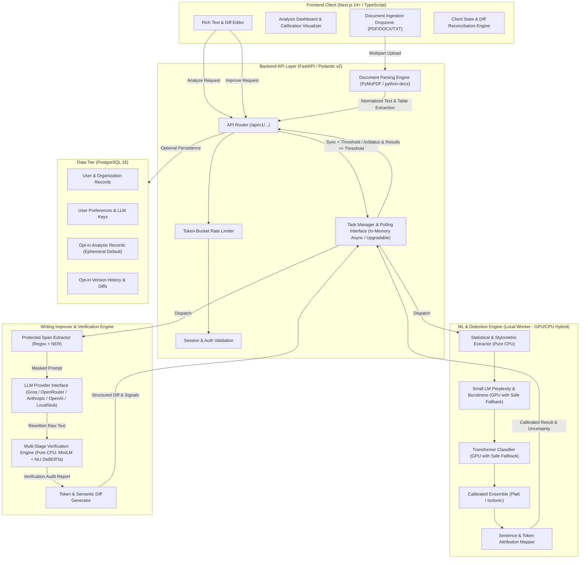
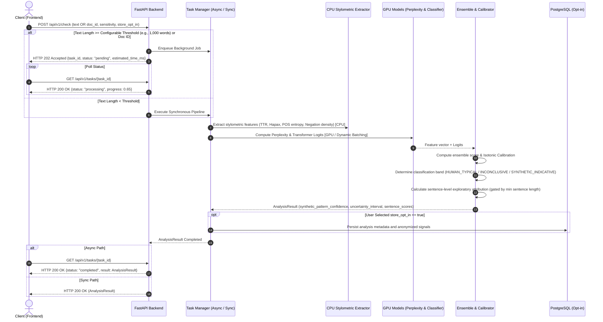
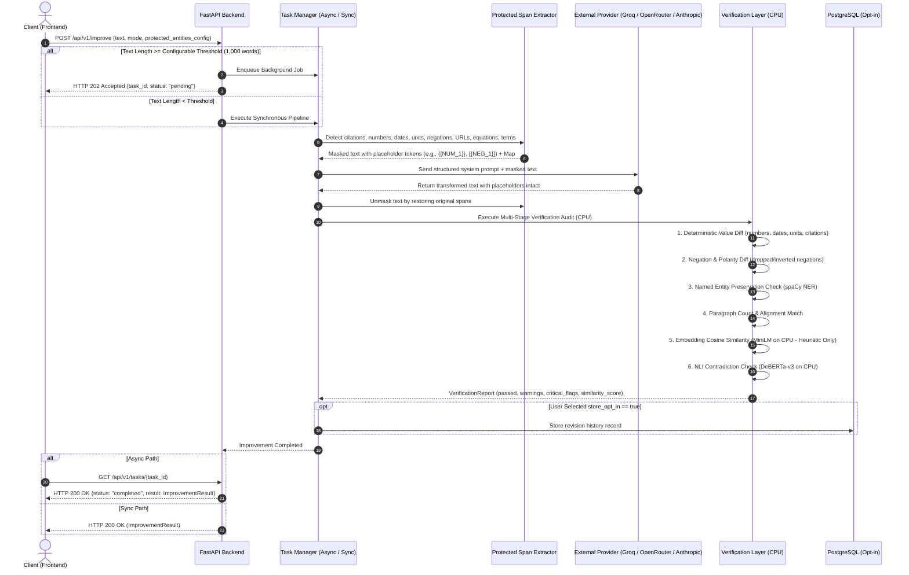

# System Architecture Specification

## 1. Executive Summary

BundCheck is a production-oriented platform providing two core capabilities:
1. **Module A (Content Checker)**: Statistically grounded, multi-signal AI text analysis. Outputs calibrated `synthetic_pattern_confidence`, explicit uncertainty intervals, sentence-level exploratory attribution, and explanatory linguistic indicators. It **never** asserts absolute proof of authorship and strictly disallows "Ask an LLM if this is AI" approaches.
2. **Module B (Writing Improver)**: Multi-mode writing enhancement preserving semantic meaning, technical terms, numerical values, negations, dates, units, and academic citations. Features a strict post-generation verification audit and interactive diff review.

---

## 2. Component Architecture

---

## 3. Data Flow

### 3.1 Module A: Check (Analysis) Data Flow

### 3.2 Module B: Writing Improver & Verification Data Flow

---

## 4. Hardware Constraints & Safe Model Partitioning

### Local Hardware Profile:
- **GPU**: NVIDIA RTX 2050 (4 GB physical VRAM).
- **System Memory**: 24 GB RAM.
- **Compute Rules**:
  - Do not assume a fixed 1.4 GB peak VRAM requirement. Actual peak VRAM and RAM are dynamically measured, logged, and monitored during testing and inference.
  - Implement configurable batch sizes (`eval_batch_size: 4` default, scalable down to `1`).
  - Safe model-loading behavior: GPU memory is allocated on-demand with explicit device fallback (`device_map="auto"` or graceful CPU fallback if CUDA initialization or allocation fails).
  - Model partitioning strategy:
    - **GPU (CUDA)**: `DistilGPT-2` (Perplexity / Burstiness) and `DistilRoBERTa` (Sequence Classification).
    - **CPU (PyTorch / ONNX Runtime)**: `all-MiniLM-L6-v2` (Sentence Embeddings) and `cross-encoder/nli-deberta-v3-small` (Contradiction Detection). Offloading verification to CPU guarantees that GPU VRAM is never contested during rewrite auditing.
    - **External Provider Interface**: All large generative model inference is routed to external providers (Groq, OpenRouter, Anthropic, OpenAI) or the deterministic local stub for CI.

---

## 5. Persistence & Privacy Architecture: Stored vs. Not Stored

Privacy and confidential handling of user text is an absolute architectural requirement.

| Data Entity | Default Policy | Opt-in Persistence Policy |
|---|---|---|
| **Raw Input Text** | **Never Stored**. Processed in ephemeral memory and discarded immediately after response dispatch or task completion. | Stored in PostgreSQL with AES-256 encryption at rest only if user explicitly toggles `store_history: true`. |
| **Uploaded Files (PDF/DOCX)** | **Never Stored on Disk**. Streamed to memory, parsed, and immediately released. | Original binary file is never saved regardless of opt-in; only extracted text if opt-in enabled. |
| **Analysis Signals (Confidence, Entropy)** | Ephemeral in memory. Discarded after task delivery. | Stored linked to `analysis_id` with 30-day default TTL if opted in. |
| **Protected Entity Maps** | Ephemeral. Destroyed immediately post-unmasking. | Ephemeral. Destroyed immediately post-unmasking. |
| **User Account & Settings** | Persisted (Email, Hashed Password, Encrypted BYOK Keys). | Persisted. |

---

## 6. Security, Ingestion & Document Parsing Safeguards

### 6.1 Upload Validation & Ingestion Hardening
- **Magic Bytes Validation**: File extensions are ignored. Ingestion inspects raw header magic bytes:
  - PDF: `%PDF-` (`0x25 0x50 0x44 0x46`)
  - DOCX: `PK\x03\x04` (`0x50 0x4B 0x03 0x04`) validated against ZIP manifest for Office OpenXML structures.
  - TXT: Valid UTF-8 / ASCII byte sequences; rejected if null bytes (`0x00`) or binary control characters are detected.
- **Size Limits**: Hard ceiling of 10 MB per document; maximum word count 50,000 words.
- **Decompression Bomb Defense**:
  - DOCX files are compressed ZIP archives. The parser enforces an uncompressed-to-compressed ratio limit of 20:1 and an absolute uncompressed size ceiling of 50 MB.
  - Archives containing nested ZIP files or more than 1,000 XML entries are rejected immediately.
- **Macro Defense**: Files containing `vbaProject.bin` or macro relationship schemas (`.docm`) are rejected with HTTP 422.

### 6.2 Document Extraction & Table Handling Clarification
- **Text Normalization**: Unicode NFKD normalization, ligature unfolding (`fi` $\to$ `fi`, `fl` $\to$ `fl`), and hyphen-stitching at line breaks to prevent artificial perplexity spikes and regex misses.
- **Table Handling**:
  - **Standard Grid Tables**: Simple tabular structures with clear row/column delimiters in DOCX or clean text tables in PDF are extracted into Markdown pipe-table format (`| col1 | col2 |`).
  - **Unsupported Table Structures**: Multi-layer nested tables, vertically merged cells, or irregular graphical layout grids that cannot be converted cleanly are skipped to avoid corrupting text flow.
  - **Skipped Elements Metadata**: All skipped or unparseable elements (nested tables, vector drawings, images, headers, footers, footnotes) are explicitly reported in the extraction response metadata (`unsupported_elements: ["nested_table_page_3", "footer"]`).

### 6.3 Content-Free Logging & Secret Safety
- Production logging (`structlog`) strictly forbids logging user document content, raw text, or generated diffs. Logs capture only request metadata (`user_id`, `task_id`, `word_count`, `latency_ms`, `peak_vram_mb`, `status_code`).
- User BYOK keys are encrypted using AES-GCM-256 with an application master key before storage.

---

## 7. Asynchronous Task Interface Architecture

To ensure operational responsiveness and prevent gateway timeouts on large documents:
- **Execution Threshold**: Text length $\ge 1,000$ words (configurable via `ASYNC_TASK_WORD_THRESHOLD`) or direct file extraction triggers asynchronous processing.
- **Task Management**: Managed via an abstract `TaskManager` interface. Initial implementation uses an in-memory `asyncio` task queue with thread-safe state storage.
- **Upgradability**: The `TaskManager` interface cleanly decouples FastAPI from queue mechanics, allowing seamless drop-in of Redis/Celery in Phase 9 if multi-instance distributed horizontal scaling becomes necessary.
- **Polling & Contract**: Returns HTTP 202 with `task_id` and retry estimate; polled via `GET /api/v1/tasks/{task_id}`.
